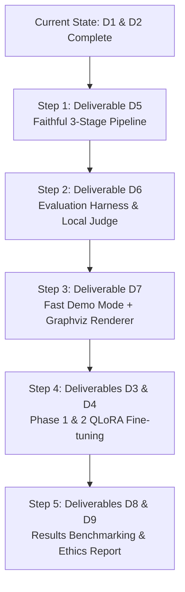

# Clinical Diagnostic Reasoning Pipeline — Context Transfer & Handover


## Behavior audit and reference correction — latest October 29, 2026

User requested clear decomposition of broad base/D4 behavior BEFORE finishing
Graphviz/form delivery. MODEL_BEHAVIOR_REPORT.md is the detailed report; script
scripts/analyze_model_behavior.py reproduces data/evaluation/behavior_audit/audit.json.
CRITICALCORRECTION: two metadata PDDs are broader than actual annotation roots:
COPD case15166831 -> ModerateCOPD, HeartFailure11465548 ->HFmrEF. D4 matchesboth.
Corrected annotation-root accuracy BASE15/25,D417/25; metadata15/25both preserved.
Incorrectcompletedroot outputs BASE6,D47 (earlierD49waswrongendpoint). Conditional
completedaccuracy15/21vs17/24 nearlyequal. Paired:14bothcorrect,3D4only(COPD,HF,
pneumonia),1baseonly(AsthmaCOPD),7bothwrong. Current deployed default BASE unchanged
while user reviews audit. D4 is now stronger provisional diagnosis+speed candidate;
do not repeat tie/noimprovement as complete interpretation.

Evaluator adds separate diagnosis_annotation_root_correct and summary rootaccuracy,
plus reference labels. Metadata metric preservedforhistory. New offline rerun
 data/evaluation/d6_dev_reference_audit exposesbothendpoints; all semanticmetrics
unchanged vs historicalD6run. Regressiontest root!=metadata passed. No newmodel
inference/training/finaltest by this audit. AssessmentCPUtime chargedledger.

Behavior: D4rationale11.3wordsvsbase49; evidenceIDs exactly1 in59/59 decisions,
base6.81mean; D4neverUncertain/STOP,base3Uncertain+1STOP. Trainingreason344targets:
342singleID,1two,1three;0STOP;13.4wordmean. Strongformatimitation, plausible
sourceofsingleanchor/commitmentbehavior. Shared16correctcategorycases isolate
extraction:base300obs/108matches,D4234/109;semanticF1 .509vs.609.
Same16casesexplanationbase31/37matched,D428/37;uncalibratedproxiesnotclinicaltruth.
Majorerrors: wrongcategoryanchoring,targetfocusvsannotation(chiefcomplaintvs
lipids/BP),syndromeversusetiology(UGIBvsulcer),PEseverity/temporalstate. BaseHF
rationaleexplicitlyquotes45–50%thenclaimsmeets<=40%;D4matchedHFmrEF. LowriskPE D4
MassivePEbasedonlychestpain. BothMassivePEcaseignore/downweightinitialBP76/52,
chooseSubmassive. Moretrainingofsamepositivesnotdirectfix.

Graphviz/form work IS IMPLEMENTED and live-tested, deliveryfinishing was paused:
portableofficialGraphviz16.1.0 verifiedin tools/graphviz; setup_graphviz.py,
src/demo/graphviz_renderer.py rendersvalidatedDOT/SVG/PNG; sourceevidenceblue,
rationaleyellow,diagnosisgreen. runner.py sharedCLI/web,modelprocesslock,report
includesgraph/downloads. Browserform stdlibloopback8765,6fields,JSONimport/example,
backgroundjobs,CSRF/host/originchecks,onecaseatatime;staticassets src/demo/web.
start_demo.ps1 starts4B+form; stop_demo.ps1 stopsboth. ALL24tests passed inclnative
Graphviz+HTTP. Livebrowsercase22d2efa1f0094408965eed2e7c0098fd producedAFin12.09s
includinggraph; artifacts data/manual_runs/thatID. ModelserverPID11896 and demo
server stillrunning at lastcheck. BrowserdemoTab in CUA sessionat127.0.0.1:8765.
Graphreadability stilltofinish: currentBT22nodegraph6722x1125verywide; considerLR
orcompactgraphview. NeedupdateMANUAL_TESTING/README/planD7statuswithlaunchcommands,
finishUIvisual/screenshotcheck and savepreview beforeconcludingoriginalrequest.
Do not download8Borregrowcaches: userauthorizeddeletedpipcache3.31GiB,HFcache0.40,
8Bweights4.68,total8.39GiB;keptalltrainingweights/checkpoints/data.

## D6 evaluation harness completed — October 29, 2026

scripts/evaluate_predictions.py scores saved runs offline. Encoder is planned
pritamdeka/S-PubMedBert-MS-MARCO pinned96786c7024f95c5aac7f2b9a18086c7b97b23036,
~0.41GiB in data/models, hashes verified and local-only inference. Existing
Torch/Transformers used; no new Python libraries. Weights-only loading, no
remote code. Model card declaresCC-BY-NC-2.0. See EVALUATION.md.

Metrics: diagnosis/category, one-to-one exact/semantic observations (samefield,
groundedpredictions), Cause-level explanation matching (samealias-normalized
milestone,similar rationale,atleastone matching evidence), diagnosticmilestone
PRF, tree errors/statuses, macro/micro counts and actual matched pairs. Threshold
0.80 explicitlyUNCALIBRATED; not clinical correctness or exact paper reproduction.
OptionalLLMjudge/humanthresholdcalibration deferred under practical project scope.

CompletedCPUevaluation of saved25casebase/D4 runs in data/evaluation/d6_dev:
baseobssemanticP/R/F1 .360/.735/.483, D4 .449/.847/.587;
baseexplanationP/R/F1 .635/.153/.246, D4 .593/.162/.255.
Diagnosisstill15/25both; selected_model.json unchanged(BASE). No new generation,
training or finaltestinference. 1005uniqueencodedtexts; evaluation28.81seconds.
21automatedtestspassed; actualencoder shortpooling equivalence andlongchunk
smokecheckspassed (encoder_check.json). Assessmenttime chargedto sharedledger.

User asked why data is22GB: inspected~23GiB. Models14.99GiB (HF4B7.51,
8BGGUF4.68,4BGGUF2.33,encoder0.41,smalladapters); pipcache3.31,
training2.80,ZIPs0.62,HFcache0.40,formatteddata~0.6. Explained separate
training/inferenceweights and optionalcache/8B cleanup. Nothing deleted.

## Latest completed checkpoint — October 29, 2026

D4 ended normally by early stopping at550. Best step400 validation loss
0.5670737710 is preserved in best.json and best/step-000400/adapter; runtime
export data/models/d4_best.gguf. Latest resume checkpoint550 remains separate.
Do not restart training automatically. D3 pilot complete; additional D3 deferred.

Completed broader matched development comparison: base15/25 and D4step40015/25,
covering24 development categories and all3 train-absent-label cases. Basecategory
17/25, D4category19/25; mean10.06s versus6.88s. D4fixed bacterial pneumonia and
regressed Asthma-COPD, with9 wrong complete leaf outputs versus base6. Both
matched2/3 absent-label cases. Keep BASE on diagnosis-count tie, as recorded in
data/models/selected_model.json. Earlier12casebase9/D4 8 is overlapping evidence.
See D4_RESULTS.md and completed data/runs/broad_{base,d4}_dev. Selection script
scripts/select_deployment_model.py checks matched IDs, source hashes, adapter
scales and source-grounded tree validity. No final-test model inference has run.

Broad comparison was interrupted when evaluation process and local server exited.
Completed base arm retained; interrupted D4 output preserved in
 data/runs/broad_d4_interrupted (excluded from scoring), D4 arm restarted alone.
Ledger charged full1200second enforced allowance conservatively, excluding idle
post-exit time. data/training/budget.json now has no active job, total9088.55s
(151.48min),88.52min headroom under4h. Never reset ledger. No more training planned.

Manual workflow implemented: scripts/test_case.py accepts input1..input6 JSON,
optionalcase_id; no answer/category fields. Uses selected_model.json by default,
explicit --model base/d4 supported. Refuses adapter changes during an active
budgeted job. Exports case.json, result.json, escaped standalone report.html.
MANUAL_TESTING.md and examples/case_template.json document input. Live test of
examples/direct_dev_case.json returned Paroxysmal Atrial Fibrillation in9.74s,
12validatedgroundednodes, at data/manual_runs/verified_demo/report.html.
All19tests passed. Server stopped after verification; restart via launcher.
D7 manual report implemented; browser form/single-pass model remain pending.
D6 semantic explanation evaluation and consolidated D9 dataset-use doc remain
pending. Do not describe loss or valid source quotes as proof of clinical quality.
The updates below preserve historical progress and may describe superseded state.

## Current implementation update — October 28, 2026

Latest recovery: D4 OOM occurred duringupdate85; checkpoint50 (val0.906158)
survived. Failed run time stays charged. Completion-only logits now avoid huge
unused prompt logits; exact loss/gradient equivalence test and replay of failing
examples passed (5374 MiB peak allocated). D4 resumed from50 with new logs
data/training/logs/d4_recovered.*. User requested minimum-loss saving: best.json
and immutable best/step-NNNNNN/adapter copies now track strict minimum VALIDATION
loss at each evaluation, separately from latest resume checkpoints. Assessment
reads best.json. Four-hour cumulative budget remains unchanged.

Latest execution checkpoint: see D4_STATUS.md. Persistent four-hour ledger is
data/training/budget.json; never reset its spent time. Matched D3 transfer check
was base9/12 vs pilot7/12 (one output-cap error). Additional D3 is deferred;
data/d3_curated holds1600 diverse unused examples. D4 starts from BASE, not the
D3 adapter. data/d4_compact has1200 train/240 dev tasks, covering350 training
annotations/all25 categories; four long Gastritis cases remain unsupported.
Longest2047-token trial passed exact save/reload. Fifteen tests pass. Verified
D4 session resumed fromstep3 via scripts/continue_d4.py, capped at600 updates and
100 minutes cumulative. It will evaluate best checkpoint on the matched12-case
development cohort and retain base unless diagnosis matches improve. Consult
data/training/d4_session_600/status.json, selection.json and logs for current
state. No final-test model predictions are authorized as part of this tuning.

USER CONSTRAINT: D3 and D4 combined must fit four hours. User requested a report
before further training. See TRAINING_BUDGET_AND_QUALITY_REPORT.md and
data/d3/four_hour_budget_proposal.json. Do not start an unrestricted full epoch.
Pilot completed 200 updates / 800 examples in ~26.5 minutes; best update200 loss
1.441871 versus 2.409445 initially on 32 monitoring cases. Qualitative direct
generation is organized but diagnoses/quotation fidelity remain unreliable;
do not attribute base pipeline scores to this adapter. Full-tree D4 targets
have median3033/max8506 tokens; only58/335 fit2048. Proposed short stage-specific
D4 targets and diversity-stratified D3 subset must share a cumulative time
ledger including already-spent time. No additional training started for report.

D3 session controller is implemented in scripts/train_d3_session.py. Exact
resume equivalence passed (504 adapter tensors, cursor, history, scheduler).
See data/training/resume_verification.json. A bounded 200-update pilot was
launched under data/training/d3_pilot_200 with gradient accumulation 4,
32-example validation/checkpoints every 50 updates, one-hour cap and early
stopping. Consult its status.json and data/training/logs for live state; launch
does not mean completion. This pilot covers at most 800 examples, not a full
training epoch. Baseline inference is not switched to the pilot adapter.

D3 preparation checkpoint supersedes earlier statements that training scripts
do not exist: see D3_STATUS.md. Data mixture: 31,754 train / 1,489 validation /
897 supplementary test. All train examples fit 2,048 tokens without truncation.
Pinned HF Qwen3-4B weights are downloaded and verified. Local CUDA training stack
works; datasets was aligned to 4.1.1 for Hub compatibility. Two-step NF4 QLoRA
trials pass at 1,024 and 2,048 limits, including exact adapter tensor and loss
equality after reload. The latter trained lengths 1,563 and 1,551, peaking at
5,907 MiB allocated / 7,356 MiB reserved. Full D3 training has not run; add
resumable full-session control and validation before a long run. Twelve tests
pass. No trained adapter has replaced baseline inference models.

Coverage/routing checkpoint: DIAGNOSIS_COVERAGE.md audits all 55 labels, with
51 in the training split and 48 in usable SFT. Development has three cases with
labels absent from train (Hypertrophic Cardiomyopathy, Massive PE, Thyroiditis);
all have KGs. Test metadata only was inspected; no test inference was run.
On a matched 12-case development cohort, single routing achieved 9/12 diagnosis
matches (7/9 present-label, 2/3 absent-label) at 11.0s/note. Optional shortlist
routing achieved 6/12 (4/9 and 2/3) at 12.0s/note; it lost three successes and
fixed none. Keep single routing as default. See ROUTING_CHECK.md. Shortlisting
included the expected category in 11/12 cases, but comparison over-abstained.
Ten tests pass. Runner summaries now stratify performance by training split
and usable SFT label coverage; no project fine-tuning has run.

Supplementary acquisition completed on October 28: MedCaseReasoning has
13,092 train / 500 validation / 897 test records; Medical-O1 has 19,699
formatted English-subset records (five excluded by the existing language
filter). See data/supplementary/validation.json for format checks.
Inspect data/supplementary_logs/download.stderr.log and
data/supplementary/manifest.json for acquisition counts.
The downloaders now use pinned source revisions, MedCaseReasoning's default
configuration and Medical-O1's English medical-only subset, handle its official
capitalized fields, and retain source/split/row metadata. All HF caches are
project-local. Eight tests pass. Native splits remain separate; no supplementary
validation/test records are silently mixed into training. Output records share
instruction/input/output with DiReCT; supplementary targets remain narrative
reasoning, not fabricated DiReCT annotations.

This update supersedes conflicting details in the historical handover below.
The objective is best practical performance on the 8 GB GPU, without extensive
research ablations. See README.md for current commands and policies.

**Live checkpoint:** See BASELINE_STATUS.md. With corrected routing and source
passage selection, 4B matched 8/10 development diagnoses at 10.9 seconds/note;
8B matched 5/10 at 14.3 seconds/note. This is a tuned, small debugging subset,
not final accuracy. Keep 4B as the provisional default. Both models are stored
locally; observed GPU usage was about 4/6 GiB respectively. Six unit tests and
live output integrity checks passed. The test server was stopped after checks.
Next: broaden development coverage, then decide whether training is warranted.

- Runtime and model now live inside the project: CUDA llama.cpp b11951 under
  tools/llama.cpp, official Qwen3-4B Q4_K_M under data/models. Downloaded assets
  are SHA-256 verified. No global installs or Ollama are required.
- Data identities are annotation-relative paths (`sample_id`). The dataset has
  511 annotations but 499 original note IDs; ambiguous legacy ID lookups fail.
- Frozen patient-grouped splits are in data/splits_v2: 354 train, 77 dev, 80
  final test. There are 335 KG-supported SFT records. data/splits is historical
  and must not be used for new experiments. Development tuning never uses test.
- Conservative aliases resolve STEMI, COPD Asthma and pituitary singular/plural
  naming. Thyroid Nodules is an internal KG milestone. Four Severe Asthma
  Exacerbation labels remain distinct from the KG's Severe Asthma label.
- Two source observations are attached directly to diagnoses without rationales;
  they remain in source trees and observation metrics, not fabricated triples.
- Gastritis classification returns unsupported_kg rather than inventing a KG.
- src/pipeline contains a loopback-only client, classification, per-field
  extraction, KG descent, deterministic tree assembly and validation. Canonical
  links are parent/children, with the current/final diagnosis at the root.
- scripts/run_pipeline.py runs small balanced development batches and records
  category/diagnosis accuracy, exact-span observation diagnostics, status,
  latency, token usage and source hashes. This is not the paper's evaluator.
- D3/D4, synthetic augmentation and the visual demo are still pending. D2's
  supplementary downloader code exists, but datasets have not been acquired or
  verified. Current local checks: python -B -m unittest discover -s tests -v.

The original handover follows for historical context.

> **Document Version:** 1.0.0  
> **Date:** October 28, 2026  
> **Target Audience:** Incoming AI Agent / Collaborating Engineer  
> **Working Directory:** `d:\Projects\Clinical Diagnostic Reasoning`  
> **Master Architecture Document:** Refer to [PROJECT_PLAN.md](file:///d:/Projects/Clinical%20Diagnostic%20Reasoning/PROJECT_PLAN.md)

---

## 1. Executive Summary & Objective

This project reproduces and extends the **DiReCT** clinical diagnostic reasoning benchmark (*"DiReCT: Diagnostic Reasoning for Clinical Notes via Large Language Models"*, Wang et al., NeurIPS 2024).

The core task is to evaluate and improve how Large Language Models perform multi-stage clinical diagnostic reasoning over unstructured clinical notes, decomposing the reasoning process into an entailment tree:
$$\text{Clinical Observations (Input)} \longrightarrow \text{Clinical Rationales (Cause)} \longrightarrow \text{Diagnostic Milestones / Primary Diagnoses (Intermedia)}$$

---

## 2. Hard Constraints & Environment Policy

1. **Strictly 100% Offline (No Cloud LLM APIs):**
   - Out-of-bounds: OpenAI API, Claude API, Gemini API, or any external HTTP LLM endpoints.
   - All models (inference backbone, evaluation judge, fine-tuning targets, and demo mode) must run locally on-device.
   - Rationale: Patient Health Information (PHI) privacy and strict adherence to project scope.

2. **Local Hardware Profile:**
   - **GPU:** NVIDIA GeForce RTX 4060 Laptop GPU (8,188 MiB VRAM, Compute Capability 8.9 / Ada Lovelace).
   - **OS:** Windows 11 (64-bit).
   - **VRAM Constraint:** 8 GB VRAM requires strict memory discipline:
     - 4-bit quantized GGUF (via Ollama or llama.cpp) for 8B inference (~5 GB VRAM).
     - QLoRA with 4-bit NF4 (`bitsandbytes` / Unsloth) targeting 3B parameter models (e.g., Llama-3.2-3B-Instruct) for training within 6–7 GB peak VRAM.

3. **Virtual Environment Isolation (No Global Installs):**
   - All Python libraries, modules, and dependencies **must reside strictly inside the project virtual environment**:
     `d:\Projects\Clinical Diagnostic Reasoning\venv`
   - Never use global `pip install`. Always invoke through `.\venv\Scripts\python.exe` or `.\venv\Scripts\pip.exe`.
   - All dataset downloads and caching must go into `data/` or `data/.hf_cache`, never user home global caches if avoidable.

---

## 3. Directory Layout & Repository Structure

```text
d:\Projects\Clinical Diagnostic Reasoning\
│
├── venv\                                # Dedicated project Python 3.13 venv (ALL LIBS INSTALLED HERE)
├── mimic-iv-ext-direct-1.0.0\            # Source DiReCT dataset (511 clinical notes, 24 KGs)
│   ├── diagnostic_kg\
│   │   └── Diagnosis_flowchart\        # 24 disease category knowledge graphs (.json)
│   └── samples\
│       └── Finished\                   # 511 annotated clinical notes (25 category subfolders)
│
├── src\
│   ├── __init__.py
│   └── data\
│       ├── __init__.py
│       ├── structures.py               # RecordNode, InputContent, DiagnosticChain, KnowledgeGraph
│       ├── loader.py                   # DiReCTDataset, load_sample, cal_a_json & deduction_assemble ports
│       └── download.py                 # Downloaders for MedCaseReasoning, Medical-O1, and SFT formatting
│
├── scripts\
│   ├── validate_loader.py              # D1 validation script (dataset verification & stats)
│   └── download_datasets.py            # D2 CLI runner for supplementary dataset acquisition
│
├── data\                                # Local data directory (splits, caches, SFT records)
│   └── splits\
│       ├── direct_splits\
│       │   ├── train_ids.json          # 416 stratified training note IDs
│       │   └── eval_ids.json           # 95 stratified evaluation note IDs
│       ├── direct_sft\
│       │   └── direct_train.jsonl      # 394 generated DiReCT entailment tree SFT records
│       └── manifest.json               # Export manifest
│
├── requirements.txt                    # Project dependency specification
├── PROJECT_PLAN.md                     # Comprehensive architecture and curriculum plan
└── CONTEXT_TRANSFER.md                 # This handover document
```

---

## 4. Work Completed to Date

### Phase 1: Planning & Architecture (Completed)
- Conducted research on dataset size limits, offline local models for 8GB VRAM, and evaluation alternatives to frontier API judges.
- Created [PROJECT_PLAN.md](file:///d:/Projects/Clinical%20Diagnostic%20Reasoning/PROJECT_PLAN.md), detailing:
  - 3-Phase training curriculum (MedCaseReasoning 14.5k $\to$ Medical-O1 $\to$ DiReCT SFT).
  - 3-Stage pipeline specification (Narrowing-down $\to$ Perception $\to$ Reasoning loop).
  - Fast single-pass demo mode with Graphviz visualization.
  - Evaluation harness porting paper metrics (`Acc_diag`, `Obs_prec`, `Obs_rec`, `Obs_comp`, `Exp_com`, `Exp_all`).

### Phase 2: Virtual Environment Setup (Completed)
- Initialized isolated venv at `d:\Projects\Clinical Diagnostic Reasoning\venv`.
- Upgraded pip and installed core foundational packages (`datasets`, `huggingface-hub`, `tqdm`, `pandas`, `pyarrow`).

### Phase 3: Deliverable D1 — Data Loader & Schema Port (Completed & Verified)
- Implemented `src/data/structures.py`:
  - `NodeType` enum (`Input`, `Cause`, `Intermedia`).
  - `RecordNode` representing tree nodes, handling complex keys, parent/child IDs, source field binding, and hierarchy depth.
  - `InputContent` managing the 6 standard clinical text fields (Chief Complaint, HPI, PMH, Family History, Physical Exam, Pertinent Results).
  - `DiagnosticChain` holding flattened reasoning triples $(o \to z \to d)$ extracted from tree paths.
  - `KnowledgeGraph` and `KGNode` representing diagnostic trees and textbook premises.
  - Robust regex `_KEY_PATTERN = re.compile(r"^([\s\S]+?)\$(Input|Cause|Intermedia)_?(\d+)\Z")` supporting multi-line strings, arbitrary spacing, and variable digit suffixes.
- Implemented `src/data/loader.py`:
  - Full faithful port of the official DiReCT repo's `cal_a_json` and `deduction_assemble`.
  - Recursive tree assembly and bidirectional wiring.
  - `DiReCTDataset` high-level abstraction indexing notes by ID, disease category, and PDD.
- Tested and verified with `scripts/validate_loader.py`:
  - **511 / 511** clinical notes parsed cleanly.
  - **5,109** observation nodes, **5,115** rationale nodes, **1,565** intermediate diagnosis nodes.
  - Zero unparsed/skipped keys.
  - Unicode/console handling verified for medical symbols (e.g. $\mu$, Greek characters, arrows).

### Phase 4: Deliverable D2 — SFT Data Formatter & Downloader (Completed & Verified)
- Implemented `src/data/download.py`:
  - `download_medcase_reasoning()`: Stanford MedCaseReasoning (14,489 cases) preprocessor.
  - `download_medical_o1()`: FreedomIntelligence Medical-O1 CoT reasoning preprocessor.
  - `create_stratified_split()`: Stratified 80/20 train/eval splitting across all 25 disease categories.
  - `generate_direct_sft_data()`: Converts raw DiReCT annotation trees into structured prompt $\to$ JSON completion pairs.
- Executed local split generation:
  - Stratified split created: **416 train notes**, **95 eval notes**.
  - Generated `394` training records in `data/splits/direct_sft/direct_train.jsonl`.
  - Manifest logged to `data/splits/manifest.json`.

---

## 5. Critical Dataset Insights & Edge Cases

When continuing work on this codebase, keep the following dataset properties in mind:

1. **The "Gastritis" Category KG Anomaly:**
   - The sample notes include a `Gastritis` category (27 notes with subtypes `Acute Gastritis`, `Chronic Atrophic Gastritis`, and `Chronic Non-atrophic Gastritis`).
   - However, `diagnostic_kg/Diagnosis_flowchart/` contains only **24** JSON files and does **not** include a `Gastritis.json`.
   - The loader correctly logs a missing KG warning for Gastritis notes during SFT generation. In the reasoning pipeline, when a note is classified as `Gastritis`, the pipeline should either:
     - Use a synthesized fallback KG created from the samples' ground-truth tree, or
     - Restrict KG-guided reasoning to the 24 categories with official KGs.
2. **Annotation Key Multi-line Formats:**
   - Raw keys in sample JSONs often contain multi-line quoted lab results (e.g. `cTropnT-0.55*\ncTropnT-0.66*...$Input6`). The parser in `src/data/structures.py` handles this using `[\s\S]+?`.
3. **Evaluation Integrity:**
   - 511 notes is an evaluation benchmark. The 95 notes in `data/splits/direct_splits/eval_ids.json` must be strictly held out if evaluating fine-tuned models. For zero-shot prompted baseline runs, all 511 notes can be evaluated to match the paper's Table 3.

---

## 6. Next Steps & Implementation Roadmap

The next agent should proceed in the following order:



### Step 1: Implement Deliverable D5 — Faithful 3-Stage Prompting Pipeline
- Create package `src/pipeline/`:
  - `client.py`: Local LLM runner interface (communicating with local Ollama instance at `http://localhost:11434` or via `llama-cpp-python`).
  - `narrowing.py`: Stage 1 module. Prompts model with input1–input6 to predict 1 of 25 disease categories.
  - `perception.py`: Stage 2 module. Uses matched disease KG criteria to extract verbatim clinical observations and source field tags.
  - `reasoning.py`: Stage 3 module. Iterative KG tree descent checking child premises and constructing the entailment tree.
  - `pipeline.py`: Orchestrator tying Stages 1–3 together, producing a result JSON per note matching the ground-truth schema.

### Step 2: Implement Deliverable D6 — Evaluation Harness
- Create package `src/eval/`:
  - `matcher.py`: Semantic matching module. Instead of expensive cloud LLMs, implement:
    - Primary: Clinical sentence transformer (e.g. `sentence-transformers` with `PubMedBERT` or `all-MiniLM-L6-v2`) inside venv to compute cosine similarity between predicted and ground-truth observation/rationale texts.
    - Secondary: Local LLM judge prompt for verification.
  - `metrics.py`: Implement the 3 metric families from the DiReCT paper:
    1. $\text{Acc}_{\text{diag}}$: Exact or semantic match of final PDD against ground-truth leaf node.
    2. $\text{Obs}_{\text{prec}}$, $\text{Obs}_{\text{rec}}$, $\text{Obs}_{\text{comp}}$: Observation precision, recall, and overlap against ground-truth $Input$ nodes.
    3. $\text{Exp}_{\text{com}}$, $\text{Exp}_{\text{all}}$: Explanation completeness and soundness over reasoning deduction steps.
  - `runner.py`: Evaluator taking model outputs against `ClinicalSample` objects and outputting a metrics summary table.

### Step 3: Implement Deliverable D7 — Fast Demo Mode & Renderer
- Create `src/demo/`:
  - `fast_pipeline.py`: Single-pass structured generation using local LLM with grammar / JSON constraint to output the complete tree directly in <15s.
  - `visualizer.py`: Graphviz layout generator emitting Figure 3/6/7 style diagrams:
    - Left column: Input observations (blue nodes, labeled by source field).
    - Middle column: Rationales / causes (yellow nodes).
    - Right column: Diagnostic chain milestones (green nodes).
    - Rendered to PNG/SVG using Graphviz.

### Step 4: Deliverables D3 & D4 — Optional Fine-Tuning Execution
- If fine-tuning is triggered:
  - Run supplementary dataset downloads:
    `.\venv\Scripts\python.exe scripts\download_datasets.py --datasets medcase medical_o1`
  - Fine-tune Llama-3.2-3B-Instruct using QLoRA (`Unsloth` / `PEFT` / `TRL`) on the RTX 4060 Laptop (8GB VRAM limit).
  - Target modules: `q_proj`, `k_proj`, `v_proj`, `o_proj`, `gate_proj`, `up_proj`, `down_proj`.
  - Batch size 1 or 2 with gradient accumulation steps 4–8; `paged_adamw_8bit`.

---

## 7. Verification & Run Commands Quick Reference

All commands must be run from `d:\Projects\Clinical Diagnostic Reasoning`:

```powershell
# 1. Run Data Loader verification (Deliverable D1)
.\venv\Scripts\python.exe scripts\validate_loader.py

# 2. Re-generate DiReCT train/eval split & SFT JSONL (Deliverable D2)
.\venv\Scripts\python.exe scripts\download_datasets.py --datasets direct_sft --output-dir data/splits

# 3. Download supplementary datasets when internet access is enabled
.\venv\Scripts\python.exe scripts\download_datasets.py --datasets medcase medical_o1 --output-dir data/supplementary

# 4. Check NVIDIA GPU status
nvidia-smi --query-gpu=name,memory.total,memory.free,temperature.gpu --format=csv
```

---
*End of Context Transfer Document.*
