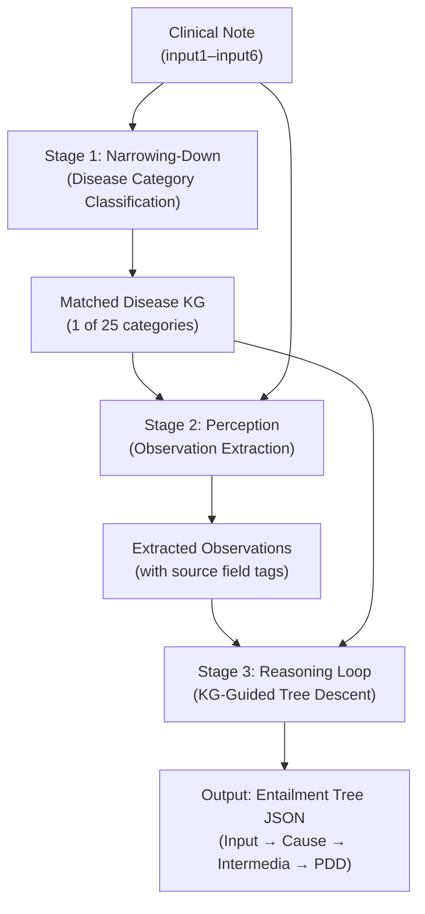
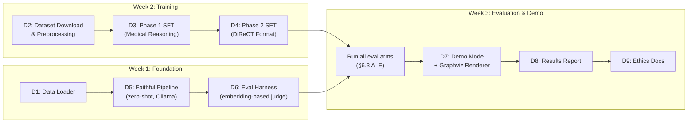

# Clinical Diagnostic Reasoning Pipeline — Revised Project Plan

> **Current scope update — October 28, 2026:** Optimize practical performance on
> the available 8 GB GPU. Extensive ablations and paper reproduction are not
> required. This document retains the original proposal below; use README.md
> and the latest CONTEXT_TRANSFER.md update for implemented behavior. Current
> runtime: project-contained llama.cpp + Qwen3-4B Q4_K_M. Authoritative patient
> splits: 354 train / 77 dev / 80 test, 335 training SFT records. D3 pilot and
> D4 budgeted training are complete; see D4_RESULTS.md for deployment selection.
> A manual JSON case interface and HTML reasoning report are implemented.
> Original
> model choices, timing estimates, schema examples and split counts below are
> historical proposals, not measured facts or current requirements.

> **Hardware baseline**: NVIDIA RTX 4060 Laptop GPU (8 GB VRAM), Windows 11
>
> **Hard constraint**: **No cloud LLM APIs** — every model call (pipeline
> inference, evaluation judge, demo mode) must run locally on-device.

---

## 1. Dataset Landscape & Augmentation Strategy

### 1.1 Primary dataset: MIMIC-IV-Ext-DiReCT v1.0.0 (already downloaded)

| Property | Value |
|---|---|
| Annotated clinical notes | **511** |
| Disease categories | **25** (with 65+ leaf-level PDDs) |
| Diagnostic knowledge graphs | **24** JSON files |
| Annotation schema | Entailment trees: Input → Cause → Intermedia → PDD |

> [!IMPORTANT]
> 511 notes is small for fine-tuning but **is the only dataset with the
> specific DiReCT-style entailment-tree annotations** needed to evaluate the
> paper's metrics (Acc_diag, Obs_prec/rec/comp, Exp_com/all). No alternative
> dataset provides these structured reasoning trees. This dataset remains the
> **sole evaluation benchmark**; augmentation targets training data only.

Distribution across categories (top-heavy):

| Category | Count | Category | Count |
|---|---|---|---|
| Acute Coronary Syndrome | 65 | Adrenal Insufficiency | 20 |
| Heart Failure | 52 | Pneumonia | 20 |
| GERD | 41 | COPD | 19 |
| Pulmonary Embolism | 35 | Aortic Dissection | 14 |
| Hypertension | 32 | Asthma | 13 |
| Peptic Ulcer Disease | 28 | Diabetes | 13 |
| Stroke | 28 | Pituitary Disease | 12 |
| Gastritis | 27 | Alzheimer | 10 |
| Multiple Sclerosis | 27 | Thyroid Disease | 10 |
| Atrial Fibrillation | 10 | Cardiomyopathy | 9 |
| Epilepsy | 8 | Upper GI Bleeding | 7 |
| Tuberculosis | 5 | Migraine | 4 |
| Hyperlipidemia | 2 | | |

### 1.2 Supplementary training datasets (for fine-tuning only, not evaluation)

Since 511 notes is too small for robust supervised fine-tuning, we augment
with publicly available datasets that teach the model **clinical reasoning
patterns** without needing DiReCT-specific annotation trees:

#### A. MedCaseReasoning (Stanford / zou-lab) — **14,489 cases**
- **Source**: [HuggingFace: zou-lab/MedCaseReasoning](https://huggingface.co/datasets/zou-lab/MedCaseReasoning)
- **Contents**: Real case reports with `case_prompt` (detailed patient presentation),
  `diagnostic_reasoning` (numbered clinician reasoning steps), `final_diagnosis`
- **Split**: 13,092 train / 500 val / 897 test
- **Why**: Teaches structured diagnostic chain-of-thought; cases are ~2.5x longer
  than MedQA; covers 30+ specialties; **freely downloadable, no DUA required**
- **Use**: Pre-fine-tune the model on general clinical reasoning before
  specializing on DiReCT-format trees

#### B. Medical-O1-Reasoning-SFT (FreedomIntelligence) — **~40K+ examples**
- **Source**: [HuggingFace: FreedomIntelligence/medical-o1-reasoning-SFT](https://huggingface.co/datasets/FreedomIntelligence/medical-o1-reasoning-SFT)
- **Contents**: Medical questions paired with explicit multi-step chain-of-thought
  reasoning chains and verified answers (EN + ZH)
- **Why**: Teaches deep clinical CoT patterns; used to train HuatuoGPT-o1; pushes
  small models toward structured multi-step clinical logic
- **Use**: Phase-1 SFT to instill general medical reasoning ability before
  DiReCT-specific training

#### C. MIMIC-IV-Note (full, if PhysioNet access available) — **~331K discharge summaries**
- **Source**: [PhysioNet MIMIC-IV-Note](https://physionet.org/content/mimic-iv-note/)
- **Contents**: ~331,000 discharge summaries with linked ICD-9/10 codes via
  `diagnoses_icd.csv` from MIMIC-IV-Hosp
- **Why**: Same hospital system as DiReCT; provides massive in-domain text for
  continued pre-training or generating synthetic note→diagnosis pairs
- **Use**: *(Optional, requires existing PhysioNet credentials)* Filter to notes
  matching DiReCT's 25 disease categories by ICD code, extract
  note-section→diagnosis pairs for additional SFT data. Can yield **5,000–15,000**
  filtered training pairs for the relevant disease categories.
- **Caveat**: These notes lack DiReCT-style entailment-tree annotations, so they
  can only train the model on note→diagnosis mapping, not on structured
  observation-reasoning chains

### 1.3 Is the full MIMIC-IV useful here?

> [!NOTE]
> **Yes, but with limits.** The full MIMIC-IV structured tables (diagnoses_icd,
> procedures, labs, vitals) + MIMIC-IV-Note discharge summaries can be joined by
> `hadm_id` to create note→ICD-code training pairs. This is valuable for:
> - Teaching the narrowing-down stage (clinical note → disease category)
> - Providing abundant in-domain text for continued pre-training
>
> However, MIMIC-IV **cannot substitute for DiReCT** because:
> - It has no physician-annotated diagnostic reasoning trees
> - It has no observation→rationale→diagnosis entailment chains
> - Evaluation metrics (Obs_prec/rec, Exp_com/all) require DiReCT annotations
>
> **Verdict**: Use MIMIC-IV-Note as supplementary training data (filtered by
> relevant ICD codes); keep DiReCT 511 notes as the evaluation set.

### 1.4 Synthetic data augmentation (using local model)

To bridge the gap between generic medical reasoning data and DiReCT-specific
format, we generate synthetic entailment trees:

1. For each of DiReCT's 24 knowledge graphs, prompt the local model (after
   Phase-1 SFT) to generate plausible clinical scenarios and entailment trees
   conditioned on the KG premises
2. Use the KG's own textbook premises as constraints to ensure medical
   plausibility
3. Target ~20–50 synthetic examples per disease category → **~500–1,250** additional
   training samples in DiReCT's native format
4. Quality-filter using rule-based checks (valid tree structure, all referenced
   premises exist in KG, leaf matches a known PDD)

---

## 2. Model Selection (All Local, 8 GB VRAM)

### 2.1 Primary pipeline model

> [!TIP]
> On an 8 GB laptop GPU, an 8B model in 4-bit quantization is feasible for
> **inference** (~5 GB VRAM), but **training** requires aggressive optimization
> or dropping to a 3B model. We use a tiered strategy.

| Role | Model | Quantization | VRAM (inference) | VRAM (QLoRA train) |
|---|---|---|---|---|
| **Inference backbone** | Llama-3.1-8B-Instruct | GGUF Q4_K_M | ~5 GB | N/A |
| **Fine-tuning target** | Llama-3.2-3B-Instruct | NF4 4-bit | ~2.5 GB | ~6–7 GB |
| **Fine-tuning target (alt)** | Qwen2.5-7B-Instruct | NF4 4-bit | ~4.5 GB | ~7.5 GB (tight) |

**Recommended primary path**: Fine-tune **Llama-3.2-3B-Instruct** via QLoRA
(fits comfortably in 8 GB, allows seq_len=2048, batch=2). Use the larger
Llama-3.1-8B (4-bit quantized) for zero-shot/few-shot inference and as a
comparison arm.

**Alternative**: If the 3B model is too weak on clinical reasoning, attempt
Qwen2.5-7B-Instruct QLoRA with batch_size=1, seq_len=1024, gradient
checkpointing. This is tight on 8 GB but feasible with Unsloth's memory
optimizations.

Medical-specialized alternatives to consider:
- **OpenBioLLM-8B** (Llama-3-8B fine-tuned on medical data + DPO) — strong
  biomedical baseline, may outperform generic Llama on clinical tasks even
  without further fine-tuning
- **BioMistral-7B** — pre-trained on PubMed Central, lightweight

### 2.2 Inference runtime

- **Ollama** (Windows native) for serving quantized GGUF models via local API
  (`http://localhost:11434`). Simple setup, handles CUDA automatically.
- **llama.cpp** as fallback for direct CLI inference with fine-grained control

### 2.3 Evaluation judge (replaces API-based LLM judge)

The DiReCT paper uses LLaMA3-8B as a judge for semantic matching. Since we're
fully offline, we have two options:

**Option A (Recommended): Embedding-based semantic matching**
- Use a clinical sentence-transformer (e.g., `PubMedBERT`-based sentence
  embeddings) as a bi-encoder for fast cosine similarity
- Use a cross-encoder (e.g., fine-tuned on MedSTS dataset) for high-accuracy
  pairwise semantic judgments
- **Advantages**: Deterministic, fast (milliseconds per pair), no generative
  overhead, runs on CPU if needed
- **Threshold calibration**: Manually evaluate ~50 observation pairs from DiReCT
  ground truth to set an optimal cosine similarity threshold (typically 0.75–0.85
  for clinical text)

**Option B: Local LLM judge via Ollama**
- Run Llama-3.1-8B-Instruct (Q4_K_M) via Ollama for LLM-as-judge matching
- Uses the same model as the paper's own judge (LLaMA3-8B)
- **Disadvantage**: Slower, requires GPU memory (can time-share with pipeline
  inference but not run simultaneously)

**Recommendation**: Use Option A (embedding-based) as the primary judge for
speed and reproducibility; run Option B on a random subset of 50–100 notes to
verify that embedding-based matching agrees with LLM-judge matching, and report
the correlation.

---

## 3. Training Strategy — Three-Phase Curriculum

> [!WARNING]
> DiReCT's 511 notes are explicitly intended for **evaluation only** by the
> dataset authors. Any fine-tuning on DiReCT samples is a deliberate deviation
> from intended use, which we disclose and justify as a research contribution
> (studying whether small local models can learn structured diagnostic reasoning).

### Phase 1: General Medical Reasoning SFT (~2–4 hours)

| Parameter | Value |
|---|---|
| **Data** | MedCaseReasoning train (13K) + Medical-O1-Reasoning-SFT (filtered EN subset, ~10K) |
| **Model** | Llama-3.2-3B-Instruct, NF4 4-bit |
| **Method** | QLoRA (rank=16, alpha=32, target: q/k/v/o + gate/up/down projections) |
| **Optimizer** | paged_adamw_8bit |
| **Seq length** | 2048 tokens |
| **Batch** | per_device=2, grad_accum=4 (effective=8) |
| **Epochs** | 1–2 |
| **Format** | Instruction: patient case → Response: structured reasoning + diagnosis |
| **Output** | Adapter checkpoint `phase1_medical_reasoning/` |
| **Est. time** | ~2–4 hours on RTX 4060 Laptop |

### Phase 2: DiReCT-Format Specialization SFT (~1–2 hours)

| Parameter | Value |
|---|---|
| **Data** | DiReCT train split (~410 notes, 80/20 stratified) + synthetic augmented trees (~500) |
| **Base** | Phase 1 adapter merged into base model |
| **Method** | QLoRA (rank=16) with continued LoRA on merged model |
| **Seq length** | 2048 tokens |
| **Batch** | per_device=1, grad_accum=8 |
| **Epochs** | 2–3 |
| **Format** | Input: 6 clinical text fields + disease KG → Output: JSON entailment tree |
| **Output** | Adapter checkpoint `phase2_direct_specialist/` |
| **Est. time** | ~1–2 hours on RTX 4060 Laptop |

### Phase 3 (Optional): Reinforcement via Self-Play / DPO (~2 hours)

- Generate entailment trees for training set notes using Phase 2 model
- Score them against ground truth using the evaluation harness
- Create preference pairs (correct tree preferred over incorrect)
- Run DPO for 1 epoch to sharpen tree quality
- Only pursue if Phase 2 accuracy is promising but noisy

### Data splitting

```
DiReCT 511 notes
├── Train: ~410 notes (80%), stratified by disease category
│   └── Used ONLY for Phase 2 fine-tuning + synthetic augmentation seeds
└── Eval:  ~101 notes (20%), stratified by disease category
    └── Held out for ALL metric computation
```

> [!CAUTION]
> Fine-tuning on DiReCT reduces the evaluation set from 511 to ~101 notes.
> We also run the full prompted pipeline (no fine-tuning) on all 511 notes as
> a separate evaluation arm, preserving comparability with the paper's Table 3/4.

---

## 4. Pipeline Architecture (3-Stage Faithful Pipeline)

Closely follows the DiReCT paper's own prompting methodology, adapted for a
local model:



### Stage 1: Narrowing-Down
- **Input**: Concatenated clinical note (input1–input6)
- **Prompt**: "Given the following clinical note, classify the primary disease
  category from this list: [25 categories]. Respond with ONLY the category name."
- **Method**: Zero-shot classification with the local model
- **Fallback**: If the model is unreliable at 25-way classification, use a
  lightweight classifier (Bio_ClinicalBERT fine-tuned on the 25 categories
  using DiReCT notes as training data — fast to train, high accuracy)

### Stage 2: Perception (Observation Extraction)
- **Input**: Each input field (input1–input6) separately + matched disease KG's
  `knowledge` section listing relevant risk factors, symptoms, signs, lab
  thresholds
- **Prompt**: "Given this clinical text and the following diagnostic knowledge
  for [Disease], extract all observations that are relevant to the diagnostic
  criteria. For each observation, quote the exact text from the clinical note
  and specify which input field it came from."
- **Output**: List of `{text, source_field}` observations

### Stage 3: Reasoning Loop (KG-Guided Tree Descent)
- **Input**: Extracted observations + disease KG diagnostic tree + KG knowledge
  premises
- **Method**: Starting at the root ("Suspected [Disease]"), at each tree node:
  1. Retrieve the KG premise for each child node
  2. Prompt: "Given these observations: [...], does the evidence support moving
     from [current node] to [child node]? The diagnostic criterion is: [premise].
     If yes, provide the supporting observation and your rationale."
  3. If evidence supports descent → record the (observation, cause, intermediate
     diagnosis) triple and descend
  4. Repeat until a leaf (PDD) is reached or no child is supported
- **Output**: Complete entailment tree in DiReCT JSON schema

### Output Schema (per note)

```json
{
  "Final Diagnosis$Intermedia_N": {
    "content": "Bacterial Pneumonia",
    "type": "Intermedia",
    "upper": "Pneumonia$Intermedia_3",
    "connection": [],
    "kg_premise": "Detection of specific bacteria by PCR..."
  },
  "Rationale$Cause_1": {
    "content": "Sputum culture showing S. pneumoniae confirms bacterial etiology",
    "type": "Cause",
    "upper": "Final Diagnosis$Intermedia_N",
    "connection": ["Observation$Input6"]
  },
  "Observation$Input6": {
    "content": "Sputum culture: S. pneumoniae",
    "type": "Input",
    "source_field": "input6",
    "upper": "Rationale$Cause_1",
    "connection": []
  }
}
```

---

## 5. Demo Mode (Fast Single-Pass)

### Design
- **Single LLM call**: Given the clinical note + matched disease KG, constrained
  via JSON-mode / structured output to emit the full entailment tree directly
- **Target**: <15 seconds end-to-end (limited by local model inference speed)
- **Model**: Fine-tuned Llama-3.2-3B via Ollama (fastest local option for
  structured generation)

### JSON Schema Enforcement
- Use Ollama's JSON mode or llama.cpp's grammar-constrained generation to force
  valid JSON output matching the entailment tree schema
- Post-process: Validate tree structure (connected, rooted, leaves are valid
  PDDs), attempt auto-repair for minor formatting issues

### Graphviz Rendering (< 1 second)
- Parse the JSON tree → Graphviz DOT language
- Layout: top-down (`rankdir=TB`), matching DiReCT paper Figure 3/6/7 style
  - **Left column**: Input observation nodes (blue boxes, with source field labels)
  - **Middle column**: Cause/rationale nodes (yellow boxes)
  - **Right column**: Intermedia diagnosis-chain nodes (green boxes)
  - Arrows: showing the observation → rationale → diagnosis progression
- Render to PNG/SVG via Graphviz (`dot` engine)
- Optional: Interactive D3.js/Mermaid version as stretch goal

---

## 6. Evaluation Harness

### 6.1 Metrics (following DiReCT paper exactly)

| Metric | Formula | What it measures |
|---|---|---|
| **Acc_diag** | Exact/semantic match of predicted PDD vs. ground truth PDD | Diagnostic accuracy |
| **Obs_prec** | \|matched predicted obs\| / \|all predicted obs\| | Observation extraction precision |
| **Obs_rec** | \|matched predicted obs\| / \|all ground-truth obs\| | Observation extraction recall |
| **Obs_comp** | Harmonic mean or overlap metric of Obs_prec and Obs_rec | Observation completeness |
| **Exp_com** | Fraction of ground-truth reasoning steps that have a matched predicted step | Explanation completeness |
| **Exp_all** | Fraction of predicted reasoning steps that match a ground-truth step | Explanation correctness |

### 6.2 Semantic matching implementation (local)

Porting the paper's matching approach to fully local execution:

1. **Primary matcher**: Clinical sentence-transformer bi-encoder
   - Model: `pritamdeka/S-PubMedBert-MS-MARCO` or similar PubMedBERT-based
     sentence embeddings
   - Compute cosine similarity between predicted and ground-truth
     observations/rationales
   - Match threshold: calibrated on a held-out subset (expected ~0.80)

2. **Validation matcher**: Local LLM judge (Llama-3.1-8B via Ollama)
   - Run on ~100 note pairs to verify embedding-matcher agrees with LLM judge
   - Report Pearson/Spearman correlation between the two

3. **Parsing utilities**: Port `cal_a_json` and `deduction_assemble` from the
   [official DiReCT repo](https://github.com/wbw520/DiReCT) to ensure ground
   truth is parsed identically

### 6.3 Evaluation arms

| Arm | Description | Eval set |
|---|---|---|
| **A** | Zero-shot 3-stage pipeline, Llama-3.1-8B-Instruct (Q4) | All 511 notes |
| **B** | Zero-shot 3-stage pipeline, Llama-3.2-3B-Instruct (Q4) | All 511 notes |
| **C** | Fine-tuned single-pass, Llama-3.2-3B (Phase 2 adapter) | Held-out 101 notes |
| **D** | Fine-tuned 3-stage pipeline, Llama-3.2-3B (Phase 2 adapter) | Held-out 101 notes |
| **E** | Demo mode (single-call, fine-tuned 3B) | Held-out 101 notes |

---

## 7. Resource Estimates

### Training (on RTX 4060 Laptop, 8 GB VRAM)

| Phase | Data size | Model | Est. time | Peak VRAM |
|---|---|---|---|---|
| Phase 1: Medical Reasoning SFT | ~23K examples | 3B, NF4+QLoRA | 2–4 hours | ~6.5 GB |
| Phase 2: DiReCT Specialization | ~900 examples | 3B, NF4+QLoRA | 1–2 hours | ~6.5 GB |
| Phase 3: DPO (optional) | ~400 pairs | 3B, NF4+QLoRA | 1–2 hours | ~7 GB |
| Bio_ClinicalBERT classifier | 511 notes | 110M params | 10–15 min | ~2 GB |

### Inference (pipeline run across 511 notes)

| Component | Calls per note | Tokens/call | Time/call | Total est. |
|---|---|---|---|---|
| Stage 1 (narrowing) | 1 | ~800 in, ~20 out | ~2s | ~17 min |
| Stage 2 (perception) | 6 | ~600 in, ~200 out | ~3s | ~2.5 hours |
| Stage 3 (reasoning) | 3–5 (avg) | ~500 in, ~150 out | ~3s | ~1.5–2.5 hours |
| **Total per note** | ~10–12 calls | | ~30–40s | **~4–6 hours total** |
| Demo mode (single-pass) | 1 | ~1200 in, ~500 out | ~10–15s | ~1.5–2 hours for 511 |

### Storage

| Item | Size |
|---|---|
| DiReCT dataset | ~15 MB |
| Model weights (8B, GGUF Q4) | ~4.5 GB |
| Model weights (3B, GGUF Q4) | ~2 GB |
| LoRA adapters (all phases) | ~200–500 MB |
| MedCaseReasoning dataset | ~500 MB |
| Medical-O1-Reasoning-SFT | ~1–2 GB |
| Results & outputs | ~200 MB |

---

## 8. Technology Stack

| Component | Tool |
|---|---|
| Language | Python 3.11+ |
| Local LLM serving | Ollama (primary) or llama.cpp |
| Fine-tuning framework | Unsloth + HuggingFace TRL + PEFT |
| Quantization | bitsandbytes (NF4 for training), GGUF (for inference) |
| Semantic matching | sentence-transformers (PubMedBERT bi-encoder) |
| Tree rendering | Graphviz (pydot or graphviz Python bindings) |
| Data loading | Official DiReCT repo utils (ported) |
| Experiment tracking | Local JSON logs + tensorboard |
| Dataset management | HuggingFace datasets library |

---

## 9. Deliverables Checklist

Current practical status (October 29; supersedes the historical checklist below):

| Deliverable | Implemented status |
|---|---|
| D1 / D2 | Loader, supplementary download and uniform formatting complete |
| D3 | Resumable QLoRA script and 200-update pilot complete; further generic training deferred after regression |
| D4 | Compact stage-specific SFT complete by early stopping; best step 400 saved and assessed |
| D5 | Local three-stage pipeline implemented with source-grounded tree assembly |
| D6 | Local evidence/rationale semantic matching and milestone scoring implemented and run; threshold calibration/optional LLM judge deferred |
| D7 | Manual JSON case input and HTML report verified; single-pass model/browser form pending |
| D8 | Practical development results in D4_RESULTS.md; original research comparison arms out of scope |
| D9 | Consolidated dataset-use documentation pending |

The selected default remains base: the broader matched development diagnosis
comparison tied at 15/25. D4 is retained for explicit comparison. Final-test
model inference has not run. See README.md and MANUAL_TESTING.md to use the model.

Historical proposal checklist:

- [ ] **D1: Data Loader** — Parse `samples/` and `diagnostic_kg/` into
  record_node / input_content / chain structures (port from DiReCT
  `utils.data_analysis`)
- [ ] **D2: Dataset Downloader & Preprocessor** — Scripts to download
  MedCaseReasoning and Medical-O1 datasets, format them for SFT
- [ ] **D3: Phase 1 Fine-tuning Script** — General medical reasoning SFT
  on Llama-3.2-3B with QLoRA via Unsloth
- [ ] **D4: Phase 2 Fine-tuning Script** — DiReCT-format specialization SFT
  with synthetic data augmentation
- [ ] **D5: Faithful 3-Stage Pipeline** — Narrowing-down → Perception →
  Reasoning Loop, runnable against Ollama-served local models
- [ ] **D6: Evaluation Harness** — Compute all DiReCT metrics with local
  semantic matching (embedding-based + optional LLM judge verification)
- [ ] **D7: Demo Mode** — Single-pass JSON generation + Graphviz renderer,
  targeting <15s end-to-end
- [ ] **D8: Results Report** — Comprehensive comparison across all evaluation
  arms (see §6.3), including:
  - Zero-shot 8B vs. zero-shot 3B (capability gap)
  - Zero-shot vs. fine-tuned (training value)
  - Faithful pipeline vs. single-pass demo (accuracy/speed tradeoff)
  - Embedding judge vs. LLM judge agreement
- [ ] **D9: Ethics & Dataset Use Documentation** — Explicit documentation of:
  - DiReCT's eval-only intended use and our deviation disclosure
  - Train/eval split rationale
  - Synthetic data generation methodology
  - MIMIC-IV data use agreement compliance

---

## 10. Execution Order (Recommended)



> [!TIP]
> **Parallelism opportunity**: D1 + D2 can proceed in parallel during Week 1.
> While Phase 1 SFT is training (~3 hours), run the zero-shot pipeline on all
> 511 notes to establish the baseline.

---

## 11. Expected Results & Comparison Points

Based on the DiReCT paper's own results (Table 3):

| Model | Acc_diag | Obs_prec | Obs_rec | Paper source |
|---|---|---|---|---|
| GPT-4 (API) | ~45–50% | ~55–60% | ~40–45% | Paper Table 3 |
| LLaMA3-70B | ~35–40% | ~45–50% | ~30–35% | Paper Table 3 |
| LLaMA3-8B | ~20–25% | ~30–35% | ~20–25% | Paper Table 3 |

**Our expected range** (local 3B–8B, 4-bit quantized):

| Arm | Expected Acc_diag | Notes |
|---|---|---|
| Zero-shot 8B (Q4) | 15–25% | Below paper's 8B due to quantization |
| Zero-shot 3B (Q4) | 8–15% | Significant capability gap |
| Fine-tuned 3B (Pipeline) | 25–40% | Training could close the gap significantly |
| Fine-tuned 3B (Single-pass) | 20–35% | Simpler task format, less step-by-step rigor |

> [!NOTE]
> **The gap between local small models and API frontier models is itself a
> legitimate and interesting result.** The project's contribution is
> demonstrating what level of clinical diagnostic reasoning is achievable on
> consumer hardware, and how much fine-tuning on supplementary datasets can
> close the gap.

---

## 12. Risk Mitigation

| Risk | Mitigation |
|---|---|
| 8 GB VRAM OOM during training | Use 3B model (not 8B); Unsloth memory optimization; batch=1 + grad accum; gradient checkpointing |
| 3B model too weak for clinical reasoning | Fall back to 7B Qwen2.5 with aggressive memory settings; or focus on the zero-shot 8B pipeline arm |
| Thermal throttling during long training | Train in cool environment; split training into sub-sessions; monitor GPU temp via nvidia-smi |
| Ollama/llama.cpp Windows compatibility issues | WSL2 as fallback; native llama.cpp CUDA binaries as alternative |
| Synthetic data quality too low | Rule-based filtering (valid tree structure, KG-consistent premises); human spot-check 50 samples |
| Embedding-based judge disagrees with LLM judge | Report both; use LLM judge results as sensitivity analysis |
| Model generates invalid JSON trees | JSON-mode enforcement in Ollama; post-processing repair; schema validation |

---

## 13. Dataset Ethics Statement

> [!CAUTION]
> **Mandatory disclosure**: MIMIC-IV-Ext-DiReCT v1.0.0 is explicitly designated
> by its authors as an **evaluation-only** benchmark (Wang et al., NeurIPS 2024).
> Our fine-tuning on a subset of DiReCT notes (Phase 2) is a **deliberate,
> disclosed deviation** from this intended use, motivated by the research
> question: *"Can small local models learn structured diagnostic reasoning from
> limited annotated examples?"*
>
> We mitigate this by:
> 1. Maintaining a strict 80/20 train/eval split (never training on eval notes)
> 2. Reporting zero-shot results on all 511 notes as the primary comparison
> 3. Clearly labeling fine-tuned results as obtained on a reduced eval set
> 4. Using supplementary public datasets (MedCaseReasoning, Medical-O1) as
>    the primary training corpus, not DiReCT itself
> 5. Complying with all PhysioNet data use agreement terms
