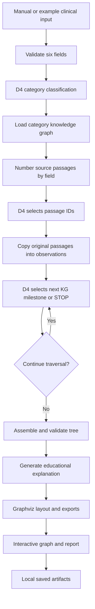

# Clinical Diagnostic Reasoning — Project Review Guide

**Implementation snapshot: October 29, 2026**  
**Selected diagnostic model: Qwen3-4B with D4 adapter, best validation step 400**  
**Hardware: NVIDIA RTX 4060 Laptop GPU, 8 GB VRAM; Windows**

This document explains the implemented system, its conceptual foundations, technical decisions, measured results, and review talking points. It distinguishes completed work from the original proposal and from unfinished assessment. The project servers were stopped at the user's request; preparing this document does not start them.

## 1. Project overview

The project builds a local diagnostic reasoning application that accepts a patient's clinical record, selects relevant evidence, follows a supplied disease knowledge graph, and presents the resulting diagnostic pathway as an interactive animated graph.

A pretrained Qwen3-4B model was adapted to the project's task format using memory-efficient training. The final D4 adapter performs diagnostic generation. Python preserves source passages, validates references, and assembles a consistent output tree. Graphviz computes the visual layout. A browser application provides manual input, example selection, saved-result exploration, fresh analysis, playback, summaries and exports. A separate teaching layer explains saved steps and medical terminology in simpler language.

The practical objective was useful performance on an 8 GB GPU within a four-hour training/assessment budget. Extensive research ablations and full paper reproduction were outside the agreed scope. The result is an educational healthcare analytics prototype, with no real clinical-environment testing.

### The problem being addressed

A diagnosis label alone does not reveal which findings influenced an answer or how a model moved from a broad suspicion to a specific subtype. Free-form model answers also make invented quotations difficult to detect. The project therefore combines:

1. Language-model interpretation of a clinical record.
2. Explicit disease milestones and criteria from supplied knowledge graphs.
3. Deterministic source handling and graph construction.
4. An interface for examining the connection between findings and conclusions.

### What explainability means here

The system exposes an explicit generated pathway with source references and criteria. This supports inspection; it does not prove medical correctness or reveal the model's internal computation. Animation replays saved decisions rather than recording hidden model thoughts.

## 2. Achievements and scope

| Area | Achieved |
|---|---|
| Data foundation | Dataset loader, canonical structures, source reconciliation, patient-grouped splits, label and KG coverage checks |
| Supplementary data | Acquisition and normalization of MedCaseReasoning and English Medical-O1 examples |
| Local inference | Project-contained llama.cpp with quantized Qwen3-4B and local HTTP client |
| D3 | Completed bounded general-reasoning pilot and downstream transfer assessment |
| D4 | Completed compact task-specific adaptation with early stopping and resumable state |
| Checkpoints | Separate minimum-loss adapter preservation and latest resumable checkpoints |
| Memory engineering | OOM recovery and completion-only vocabulary-logit loss with equivalence checks |
| Diagnostic pipeline | Category routing, source-passage selection, KG milestone selection, tree assembly and validation |
| Evaluation | Matched base/D4 comparison, reference audit, exact and biomedical semantic matching |
| Model selection | D4 step 400 selected using corrected annotated-final-diagnosis scores |
| Visualization | Graphviz SVG/PNG/DOT exports, interactive graph and autoplay |
| Interface | Six-field form, searchable examples, category filters, saved runs, summaries and presentation mode |
| Teaching layer | Plain-language text, terminology, criteria comparisons and source-only fallback |
| Operations | Local binding, serialized inference, process lock, artifact restrictions and lifecycle scripts |

Full supplementary-corpus training, a separate single-pass diagnostic model, optional LLM judging, and final-test inference were not completed. The explanation cache is partial: 12 case-cache files existed at this snapshot, and some cached milestones use fallback rather than successful generated explanations.

## 3. Data foundation

### 3.1 Primary data: MIMIC-IV-Ext-DiReCT

The primary dataset contains clinical inputs, annotated diagnostic trees, and disease knowledge graphs.

| Property | Reconciled value |
|---|---:|
| Annotation records | 511 |
| Distinct original note IDs | 499 |
| Disease categories | 25 |
| Metadata diagnosis labels | 55 |
| Supplied knowledge graphs | 24 |
| Training annotations | 354 |
| Development annotations | 77 |
| Reserved final-test annotations | 80 |
| KG-supported training records in the SFT foundation | 335 |

An annotation record is not necessarily a distinct patient or original note. Some notes have multiple annotated targets. The implementation therefore preserves original note and patient IDs while using the annotation-relative path as `sample_id`. Ambiguous note-ID lookup fails rather than selecting an arbitrary annotation.

The authoritative split directory is `data/splits_v2`; older splits are historical.

### 3.2 Why patient-grouped splitting matters

Related notes from the same patient could otherwise appear in both training and evaluation. Grouping by patient reduces that leakage route. Split membership is frozen instead of being regenerated for each experiment.

Development records were used for debugging and selection. The 80-record final-test split remains reserved, and no final-test model inference was completed. The broad reported comparison uses 25 selected development cases, not all 77 development records.

### 3.3 Clinical inputs

| Field | Clinical meaning | Interface label |
|---|---|---|
| `input1` | Chief complaint | Main concern |
| `input2` | History of present illness | Current symptoms |
| `input3` | Past medical history | Previous health conditions |
| `input4` | Family history | Family health history |
| `input5` | Physical examination | Examination findings |
| `input6` | Laboratory, imaging and investigations | Tests and scans |

Manual input accepts these six text fields and an optional `case_id`. At least one substantive clinical field is required. Unknown answer fields such as `diagnosis` are rejected.

### 3.4 Annotation structure

The source annotations are nested trees whose keys encode text and node type. The loader converts them into explicit objects and flat node dictionaries:

- **Input:** an observation associated with a clinical source field.
- **Cause:** a rationale linking evidence to a diagnostic milestone.
- **Intermedia:** an intermediate or final diagnostic milestone.

Two source annotations attach observations directly to diagnoses without a Cause node. Their observations remain usable, but the evaluator does not invent missing rationale triples.

### 3.5 Supplementary data

| Dataset | Acquired records | Purpose |
|---|---|---|
| MedCaseReasoning | 13,092 train / 500 validation / 897 test | General clinical reasoning supervision |
| Medical-O1 reasoning SFT, English subset | 19,699 records | Additional medical question/reasoning examples |
| Normalized D3 export | 31,754 train / 1,489 validation / 897 test | Shared format after preparation and deduplication |

These datasets were downloaded and reformatted. The entire normalized corpus was not exhaustively trained. Source test partitions were not substituted for the primary DiReCT benchmark. Full MIMIC-IV-Note expansion was not implemented.

### 3.6 Unique cases and unseen diagnoses

The model is not restricted to memorizing matching dataset rows. It starts with pretrained language and medical knowledge, receives explicit criteria during inference, and learns the project's task format through adaptation. Different patients can share reusable symptoms and diagnostic principles.

A diagnosis absent from project training might already have appeared in pretraining. Both base and D4 matched two of the three development cases whose labels were absent from project training; this small result does not establish diagnosis of genuinely novel diseases.

## 4. End-to-end architecture



Saved-run exploration starts from an existing D4 result and skips new diagnostic inference. Cached explanations are used where available; otherwise original evidence and rationale remain visible.

| Component | Responsibility |
|---|---|
| Qwen3-4B + D4 | Category, passage selection, milestone choice, short rationale |
| Supplied KG | Allowed diagnostic branches and associated criteria |
| Python | Prompt construction, ID checks, source copying, graph construction and statuses |
| Teaching configuration | Plain-language interpretation of an existing pathway |
| Graphviz | Visual layout and static exports |
| Browser JavaScript | Playback, selection, highlighting, navigation, pan and zoom |

The KG constrains model choices but is not a deterministic clinical rule engine. Python does not independently prove that every selected medical criterion is satisfied.

## 5. Diagnostic pipeline in detail

### 5.1 Category routing

The model receives the note and allowed categories plus `Uncertain`. It returns an evidence summary and one category in structured JSON. The prompt asks it to consider specific findings across all fields, including a chronic disease under evaluation, rather than selecting solely from the presenting complaint.

This matters because a dataset annotation can target a different problem from the most prominent admission complaint. The chosen category determines the downstream KG. A wrong route is a major bottleneck: the deployed single-category workflow cannot later jump into another disease tree.

An optional shortlist router was implemented and tested, but underperformed the single router on the matched check. Single-category routing remains the default.

### 5.2 Source-grounded observation selection

Each nonempty input field is split into original contiguous passages using line boundaries and sentence-like separators. Duplicate passages within a field are removed while preserving wording. The model sees numbered passages and selects up to 16 IDs per field, including relevant negative or contradictory findings. Empty selections are permitted.

```json
{"selected_ids": [2, 5]}
```

Python copies the passages from the source instead of accepting model-written quotations. Invalid IDs are rejected. A retained observation is represented as:

```json
{"id": "o1", "text": "FEV1 62%", "source_field": 6}
```

This replaced early free-form quote generation, which produced invented or paraphrased quotes. ID selection makes source fidelity testable. It does not guarantee that the chosen passage is relevant or sufficient.

### 5.3 Knowledge-guided milestone selection

The application presents the current candidate milestones and their criteria. The model selects a candidate or `STOP` and returns evidence IDs and a rationale:

```json
{
  "choice": "Moderate COPD",
  "evidence_ids": ["o1"],
  "rationale": "FEV1 is 62% predicted, which is consistent with moderate COPD"
}
```

The schema restricts choice values to available candidates and restricts evidence references to retained observations. A non-STOP choice requires a valid candidate, at least one evidence reference and a nonempty rationale. Traversal proceeds through child branches until a leaf, STOP, or bounded termination, with at most 20 iterations.

### 5.4 Tree construction and validation

The model does not write arbitrary graph pointers. Python converts the validated decision sequence into nodes and edges:

```text
Observation → Rationale → Milestone → Later milestone / Final diagnosis
```

In storage, the final/current diagnosis is the root, with supporting nodes beneath it. In visualization, arrows point from support toward conclusions. Earlier diagnostic milestones can support later ones.

```json
{
  "content": "Moderate COPD",
  "type": "Intermedia",
  "parent": null,
  "children": ["d1", "c2"],
  "kg_premise": "50% ≤ FEV1 < 80% predicted"
}
```

The validator checks valid node types, nonempty content, exactly one root, reciprocal parent/child references, field numbers, leaf observations, cycle detection, reachability, and verbatim grounding when clinical inputs are supplied. These are structural and source checks, not an exhaustive medical entailment proof.

### 5.5 Status handling

| Status | Meaning |
|---|---|
| `complete` | A valid generated pathway reached a KG leaf |
| `partial` | A pathway exists but did not reach a leaf |
| `abstained` | No pathway was established, including Uncertain routing or early STOP |
| `unsupported_kg` | The selected category lacks a supplied KG |
| `error` | Processing failed and the error is recorded |

Gastritis is a classification option but has no supplied KG. The application reports this gap instead of inventing a tree. `complete` describes successful traversal, not a certified correct diagnosis.

## 6. Model and local runtime

### 6.1 Deployment configuration

The deployed base is **Qwen3-4B Q4_K_M GGUF**, approximately 2.33 GiB. The D4 adapter is converted separately to `data/models/d4_best.gguf`, approximately 33 MB. A project-contained native llama.cpp executable serves inference; Python calls its local HTTP API.

The API is OpenAI-compatible in format, but does not contact OpenAI. Ollama was considered earlier and is not required by the final implementation. The native runtime is inside the project but outside the Python virtual environment; the NVIDIA driver remains a system dependency.

The earlier 8B weights and selected caches were deleted at the user's request. Historical 8B manifests do not imply that model remains installed.

### 6.2 Inference settings

- 8,192-token runtime context and one inference slot.
- GPU offload and project-contained model/runtime files.
- JSON-schema-constrained output.
- Temperature 0 and seed 42.
- Qwen thinking mode disabled using `enable_thinking=False`.
- Incomplete generation and runtime failures are recorded without silent truncation or fallback.

These settings improve repeatability; they do not guarantee identical results across every runtime version or hardware change. Pinned revisions and hashes are recorded in manifests, including the llama.cpp b11951 runtime and model snapshots.

## 7. Adaptation: D3 and D4

### 7.1 Why QLoRA

Training a foundation model from scratch was infeasible. LoRA learns low-rank updates while keeping original weights frozen:

```text
W_effective = W + scaling × B × A
```

QLoRA combines trainable adapters with a quantized frozen base. Training used NF4 4-bit quantization with double quantization, BF16 computation, rank 8, alpha 16, zero LoRA dropout and an 8-bit AdamW optimizer. Targets include attention projections and MLP gate/up/down projections. Gradient checkpointing trades recomputation for lower activation memory.

Training and deployment quantization are distinct: bitsandbytes NF4 supports the HF training process, while llama.cpp uses the Q4_K_M GGUF deployment format.

### 7.2 D3 pilot

Exhaustively training 31,754 normalized records exceeded the practical time allowance. D3 therefore completed a 200-update pilot processing 800 examples in approximately 26.5 minutes. Validation loss improved from approximately 2.40944 to 1.44187.

However, the matched pipeline check was **base 9/12 versus D3 7/12 diagnosis matches**. Further generic training was deferred. D3 completed a pilot and transfer assessment, not full supplementary-corpus training. This illustrates why a lower supervised loss cannot replace downstream evaluation.

### 7.3 D4 task preparation

D4 used runtime-like prompts with annotation-derived targets for classification, positive passage selections, and supported milestone decisions. Unannotated evidence was not automatically treated as negative. Artificial setup decisions used to reach a supervised branch were not retained as final branch targets.

The compact export contained **1,200 training tasks and 240 development tasks**, with retained training tasks covering all 25 categories and 350 annotations. This differs from the 335 KG-supported training-record foundation because classification and KG reasoning have different eligibility.

Complete examples longer than 2,048 tokens were excluded and reported, rather than silently truncating supervision. D4 started from the original HF base, not the D3 adapter.

### 7.4 D4 training configuration and outcome

- Learning rate: 0.00005.
- Two examples per optimizer update through gradient accumulation.
- Maximum sequence length: 2,048 tokens.
- Ceiling: 600 updates.
- Validation every 50 updates; patience of three non-improving checks.
- Monitored validation: 30 fixed task instances, not the full 240-task export.

| Update | Token-weighted validation loss |
|---|---:|
| Initial | 2.936171 |
| 50 | 0.906158 |
| 200 | 0.588523 |
| **400 — minimum** | **0.567074** |
| 450 | 0.574167 |
| 500 | 0.579905 |
| 550 — early stop | 0.568369 |

The run stopped at update 550 after 1,100 task examples. It did not complete an epoch over all 1,200 tasks. Step 400 is the selected best-loss adapter; step 550 is the latest resume point.

### 7.5 Best versus latest checkpoint

The best adapter is published in an immutable step-specific directory with `best.json`. Resumable checkpoints also retain optimizer, scheduler, data cursor and random-number state. Minimum-loss publication responds to any strictly lower observed validation loss, independently of the early-stopping improvement threshold. A newer checkpoint therefore cannot silently replace the best adapter.

### 7.6 OOM recovery and completion-only loss

Training ran out of memory during update 85 and resumed from checkpoint 50 after optimization. A large allocation came from producing vocabulary logits for every prompt and answer token. The revised computation retains the whole prompt as context but requests only logits needed for supervised completion prediction.

```text
Loss = average negative log probability of supervised answer tokens
```

The final prompt position predicts the first answer token; causal alignment is preserved. Loss and gradient equivalence checks passed, and the failing example pair was replayed successfully. Recovered training peaked at approximately 5,665 MiB tensor allocation, which is not a total system GPU-memory measurement.

### 7.7 Budget accounting

`data/training/budget.json` records historical work, training failures, resumed work and assessments. At this snapshot the ledger totals approximately **152.65 minutes** against the four-hour allowance, with no active session. It is an accounting record for the bounded training/assessment work, not all project development or subsequent interface inference time.

## 8. Evaluation and model selection

### 8.1 Evaluation dimensions

Diagnosis, evidence quality and explanation quality are separate. A correct diagnosis can have a weak rationale, while useful evidence can accompany a wrong subtype. Evaluation includes category matching, final-diagnosis matching, exact and semantic evidence matching, rationale-step matching, milestone agreement, structure, grounding, output status and latency.

### 8.2 Matched broad results

Both models used the same 25 development cases across 24 categories, with matched input, prompts, routing and schemas. Adapter scale was explicitly verified as zero for base and one for D4.

| Measure | Base | D4 step 400 |
|---|---:|---:|
| Annotated final-diagnosis matches | 15/25 (60%) | **17/25 (68%)** |
| Category matches | 17/25 (68%) | **19/25 (76%)** |
| Mean diagnostic inference time | 10.06 s | **6.88 s** |
| Completed leaf outputs | 21 | 24 |
| Abstentions | 4 | 0 |
| Unsupported-KG outputs | 0 | 1 |
| Incorrect completed outputs | 6 | 7 |
| Correct among completed outputs | 15/21 (71.4%) | 17/24 (70.8%) |

These are small-cohort development results. Timing predates the teaching layer and does not measure current end-to-end interface latency. No extensive repeated latency study was performed.

### 8.3 Reference-label correction

An earlier comparison reported a 15/25 tie against metadata PDD labels. Inspection found two more-specific annotation roots: **Moderate COPD** rather than COPD, and **HFmrEF** rather than Heart Failure. D4 matched both roots.

Correcting the endpoint gave 15/25 versus 17/25. Both metadata and annotation-root metrics are now reported explicitly. Historical files are retained. The paired outcomes are 14 correct for both, three D4-only successes, one base-only success, and seven wrong for both.

D4 fixed COPD, heart-failure subtype and bacterial pneumonia, while regressing on the asthma/COPD overlap case. `data/models/selected_model.json` currently selects **D4**. Older prose retaining base reflects the superseded tie-based decision.

### 8.4 Semantic evidence and rationale evaluation

Exact overlap is sensitive to passage boundaries. A local **S-PubMedBert-MS-MARCO** encoder supplies semantic cosine similarity. It uses attention-masked mean pooling, a 350-token context, nonoverlapping token chunks for longer text, token-weighted aggregation and final normalization. Files are pinned and hash-checked; remote code is disabled.

Evidence matches require the same clinical field and verbatim grounding of predicted text. Maximum one-to-one matching prevents repeated predictions from receiving duplicate credit. The default semantic threshold is 0.80.

A rationale-step match additionally requires matching normalized milestone labels, sufficient rationale similarity and at least one matched attached evidence pair. Milestone scoring uses explicit normalized label sets.

```text
Precision = matched predictions / predicted items
Recall = matched references / reference items
F1 = 2 × precision × recall / (precision + recall)
```

Micro scores pool counts; macro scores average per-case metrics. Overall observation semantic F1 was approximately **0.483 base versus 0.587 D4**. On 16 cases where both routed correctly, it was approximately **0.509 versus 0.609**, supporting improved evidence selection with routing held equal.

The threshold is uncalibrated. Similarity can miss negation, timing and numeric distinctions. These are annotation-agreement proxies rather than medical correctness scores. Optional LLM judging and human threshold calibration were deferred.

## 9. Model behavior: strengths and failures

D4 improves measured diagnosis matching, category matching, evidence selectivity and speed. It generated 5,451 completion tokens versus 11,893 for base, approximately 54% fewer. Mean reasoning-rationale length was approximately 11.3 words versus 49.

However, all 59 audited D4 reasoning decisions cited exactly one evidence ID. Of 344 training reasoning targets, 342 used one ID, one used two, one used three, and none trained STOP. The model learned concise format adherence more strongly than contrasting or rejection behavior.

A nonspecific fact can therefore support an overly specific branch. In the low-risk pulmonary-embolism case, D4 selected Massive PE from “Chest pain.” More completed trees did not mean better conditional correctness.

Base's longer explanations also failed: one heart-failure rationale quoted ejection fraction 45–50% but selected HFrEF despite a supplied lower threshold. Verbosity can hide criterion contradictions.

Shared failures include wrong-category anchoring, confusing a syndrome with its cause, ambiguity about the intended target problem, and mixing earlier unstable findings with later stable measurements. Missing KG coverage is an additional application boundary.

Future adaptation would benefit more from multiple evidence items, competing branches, explicit STOP examples and temporal comparisons than from repeating the same positive single-evidence targets.

## 10. Educational explanation layer

The teaching layer runs after diagnosis and preserves the D4 conclusion and selected evidence. For each milestone it provides the finding, everyday-language meaning, relevance to criteria, milestone definition, unresolved points, criteria comparisons and terminology.

### Model configuration

Initial D4 teaching text was overly terse. The implementation temporarily sets D4 adapter scale to zero for educational generation, using the instruction capabilities of the same resident Qwen3-4B base. A `finally` block restores the prior scale while a model lock prevents competing calls.

Thus D4 remains the diagnostic configuration, while the base configuration explains the saved output. No second GPU model is loaded. Reported diagnostic accuracy does not evaluate this newer teaching layer.

### Reference checks and limitations

Validation checks required text, lengths, exact criterion substrings, valid evidence IDs, and whether defined terms occur in the step material. Supporting/conflicting comparisons need evidence references. Curated common abbreviations supplement generated definitions, with MedlinePlus recorded as their source.

Comparison labels are `supporting`, `conflicting`, and `not_documented`. The last means not documented in the cited passages, not necessarily absent from the full record.

These checks validate references, not medical interpretations. Paraphrases and definitions may remain incomplete or wrong. If generation or validation fails, a source-only fallback preserves original evidence and rationale. Some cached milestones currently use this fallback. Universal successful lay explanation has not been established.

## 11. Casebook interface and Graphviz

### 11.1 Case exploration

The interface has Patient case, Diagnostic pathway, Case summary and Project & results views. Its example finder offers 77 cases, text search, category filtering and a saved-run filter. Twenty-five cases have saved D4 outputs.

**Load case** copies clinical input into editable fields. **Explore saved run** opens previous output without new diagnostic inference. Example IDs are stable hashes and visible labels are simple, such as Example case 17. Browse-category metadata is not supplied as a diagnostic answer to a fresh run.

### 11.2 Rendering architecture

```text
Validated nodes → DOT → Graphviz dot → SVG/PNG → Interactive HTML viewer
```

Graphviz calculates node positions and edge layout; it does not generate diagnoses. The portable executable is contained under `tools/graphviz`. JavaScript connects explicit SVG element IDs with graph metadata.

The layout runs left to right, with distinct colors for evidence, rationale and diagnosis. Long labels are abbreviated visually, while full content remains available for inspection.

### 11.3 Interaction

The graph is the default view and nonempty pathways autoplay once on opening. Each milestone progresses through evidence, rationale and conclusion phases. Controls include Pause/replay, previous/next, pace, timeline scrubbing, milestone selection and Show all.

Users can inspect nodes, connections and criteria; pan, zoom or fit; hide evidence; and focus on a step. Guided pathway provides a reading view. Original-field inspection highlights exact cited text. Definitions are available from teaching text, and presentation mode enlarges content and reduces surrounding interface.

Playback displays explicit saved decisions, not the hidden reasoning of the model. The source-code implementation respects reduced-motion styling for visual animation effects.

### 11.4 Artifacts

Each result folder under `data/manual_runs` can contain:

| File | Purpose |
|---|---|
| `case.json` | Clinical inputs |
| `result.json` | Diagnostic tree, observations, timings, explanations and provenance |
| `report.html` | Printable case report |
| `graph.dot` | Graphviz source |
| `graph.svg` / `graph.png` | Static exports |
| `graph.html` | Interactive viewer |
| `graph.js` / `graph.css` | Adjacent viewer assets |

The HTML report can be printed or saved as PDF through the browser. A separate PDF-generation service was not built.

## 12. Server and operational design

A Python standard-library threaded HTTP server binds to IPv4 loopback. New cases execute in background threads while the browser polls job state. Stage notifications identify routing, extraction, reasoning, explanation and rendering.

A thread lock serializes web inference. A PID-based file lock prevents competing CLI/background processes from changing the shared adapter configuration. Stale locks are detected, and active training/evaluation work is checked before manual execution.

The web service checks Host and Origin, requires a per-server submission token, bounds input size and serves allowlisted artifacts. The inference client ignores proxy variables and rejects redirects. These are practical local controls, not completed production-security certification.

A real defect was fixed during manual testing: saved JSON bytes were accidentally JSON-encoded again, causing “Failed to fetch.” The response handler now sends existing bytes directly, and an HTTP regression check covers loading saved result and case JSON.

The demo launcher now defaults to frontend port **8765** and model port **8082**, because 8081 was unavailable during testing. Some standalone scripts still default to 8081 and need an explicit matching port or model launch.

## 13. Demonstration preparation

### Start and stop

From the project root in PowerShell:

```powershell
.\scripts\start_demo.ps1
```

Open `http://127.0.0.1:8765` in a browser. Stop the standard launched frontend and model using:

```powershell
.\scripts\stop_demo.ps1
```

These are preparation instructions; the servers remain stopped after this document is created.

### Recommended case: Example case 17 — COPD

1. Select COPD in the finder and choose Explore saved run for Example case 17.
2. Observe the automatic evidence → rationale → milestone progression.
3. Pause and inspect the original passage and supplied criterion.
4. Use Show all to discuss the whole graph.
5. Switch to Guided pathway for the reading view; a cached step may use original-text fallback.
6. Open Case summary or export the report.
7. For fresh inference, return to input, load the case and select Build diagnostic pathway.

The saved pathway is suspected COPD → COPD → Moderate COPD. It cites a recorded post-bronchodilator FEV1/FVC below 0.70 and then FEV1 62%, matching the supplied moderate-stage interval. This demonstrates how symptoms lead to a disease category and a measurement leads to a subtype, within the supplied dataset/KG pathway.

### Suggested opening explanation

> “This application turns a clinical record into an inspectable diagnostic pathway. A locally adapted four-billion-parameter model selects evidence and follows supplied disease criteria. We preserve the original passages, build the graph in code, and expose how the generated conclusion is supported. The system was developed within an eight-gigabyte GPU constraint.”

## 14. Likely review questions

### Did you train a model from scratch?

No. We adapted a pretrained model using QLoRA. Our work includes data reconciliation, task preparation, bounded adaptation, local inference, validation, evaluation and visualization.

### Is this retrieval-augmented generation?

It provides external diagnostic knowledge during inference, but does not use a general vector-database retriever. Category selection determines the KG and candidate criteria. Biomedical embeddings are used offline for evaluation, not runtime knowledge retrieval.

### How are the KG and output graph different?

The KG describes possible milestones and criteria. The output graph records the selected evidence and milestones for one case. Graphviz lays out the latter.

### Why use a 4B model?

The objective was workable local adaptation and deployment on 8 GB VRAM. The quantized 4B model fit the practical constraints. We did not establish comprehensive superiority over larger models.

### Does low validation loss mean accurate diagnosis?

Loss measures target-token prediction, not clinical correctness. D3's lower loss accompanied worse downstream matches. D4 was selected using actual pipeline comparison as well as checkpoint loss.

### Did adaptation improve performance?

On the matched development cohort, final-diagnosis matches increased from 15 to 17 out of 25, and mean diagnostic inference decreased from 10.06 to 6.88 seconds. This is development evidence, not a final population estimate.

### Does grounding prevent hallucinations?

It controls invented quotations by copying source passages. Real evidence can still be irrelevant, misinterpreted or insufficient for the conclusion.

### Can it handle all diseases?

Traversal is bounded by supplied categories and KGs. Gastritis lacks a supplied KG. The implementation is not an unrestricted diagnostic system.

### Is the animated graph the model's actual thought process?

It shows explicit generated decisions, their cited evidence and criteria. It does not expose private internal computations.

### Why use the base configuration for explanations?

D4 is specialized for short structured diagnostic targets. Initial teaching checks were too terse, so the same local base configuration is used for instruction-oriented explanation while preserving the D4 diagnosis and restoring its adapter afterward.

### What is the strongest technical contribution?

The integrated, resource-conscious workflow: reconciled clinical data, task-specific adaptation, source-preserving inference, constrained KG traversal, audited evaluation and an interactive application.

### What should improve next?

Competing-branch and STOP supervision, multiple evidence items, temporal reasoning, missing-KG coverage, explanation quality checks and final held-out evaluation after choices are frozen.

## 15. Verification and remaining boundaries

Automated checks cover data foundations, budget enforcement, checkpoint preservation, loss equivalence, input validation, graph rendering/escaping, playback ordering, explanation-reference checks, library input isolation and HTTP behavior. The full suite reached 27 passing tests across completed checks. After the saved-JSON and default-view changes, the focused four-test demo suite passed. The final autoplay addition was propagated to saved outputs but did not receive a separate end-to-end browser playback test.

Interface development was interrupted for user manual testing. Complete browser UX verification and cache generation remain unfinished. The teaching layer has not received a broad independent clinical-quality evaluation.

Other limits:

- No final-test inference or real clinical testing.
- Small development cohort used for model decisions.
- Wrong routing can block downstream recovery.
- D4 frequently commits from one evidence item and has weak learned abstention.
- No independent deterministic medical proof of KG criteria.
- Uncalibrated semantic metrics.
- No separate single-pass model or optional LLM judge.
- No exhaustive training over supplementary data.
- Source data and model licenses/access conditions continue to apply.

## 16. Code and artifact map

Paths are relative to `D:\Projects\Clinical Diagnostic Reasoning`.

| Path | Responsibility |
|---|---|
| `src/data/loader.py`, `structures.py`, `labels.py` | Data objects, parsing and aliases |
| `data/splits_v2` | Frozen patient-grouped membership |
| `scripts/prepare_d3_data.py`, `curate_d3.py` | Supplementary preparation |
| `scripts/prepare_d4_tasks.py` | Runtime-like supervised targets |
| `scripts/train_d3_session.py`, `continue_d4.py` | Bounded training and continuation |
| `src/training/loss.py`, `best_checkpoint.py`, `budget.py` | Loss, minimum-loss publication, accounting |
| `data/training/d4_session_600/best/step-000400/adapter` | Best training adapter |
| `data/models/d4_best.gguf`, `selected_model.json` | Runtime adapter and deployment decision |
| `src/pipeline/client.py`, `pipeline.py`, `schema.py` | Model requests, diagnostic flow, validation |
| `src/evaluation` | Biomedical encoding and matching |
| `scripts/evaluate_predictions.py`, `analyze_model_behavior.py` | Offline scoring and audit |
| `data/runs/broad_base_dev`, `broad_d4_dev` | Matched saved predictions |
| `data/evaluation/d6_dev_reference_audit` | Corrected evaluation endpoint |
| `MODEL_BEHAVIOR_REPORT.md` | Detailed behavioral decomposition |
| `src/demo/runner.py`, `server.py`, `case_io.py` | Execution, API, reports |
| `src/demo/library.py`, `education.py` | Examples and teaching layer |
| `src/demo/graphviz_renderer.py`, `interactive_graph.py` | Graph exports and viewer data |
| `src/demo/web` | Browser assets |
| `data/demo_education`, `data/manual_runs` | Teaching cache and saved cases |
| `scripts/start_demo.ps1`, `stop_demo.ps1` | Standard demo lifecycle |
| `tests` | Automated verification |

## 17. Accurate claims for review

| Use | Avoid |
|---|---|
| “We adapted a pretrained 4B model using QLoRA.” | “We trained a foundation model from scratch.” |
| “D4 matched 17/25 annotated final diagnoses on the matched development cohort.” | “We established 68% clinical accuracy.” |
| “Selected passages are preserved verbatim.” | “The system cannot hallucinate or reason incorrectly.” |
| “The animation shows saved diagnostic decisions.” | “It reveals the model's actual internal thoughts.” |
| “The KG constrains diagnostic choices.” | “Software independently proves every medical criterion.” |
| “D3 completed a pilot and D4 completed a bounded early-stopped run.” | “Both full datasets were exhaustively trained.” |
| “Teaching text improves access to the explanation.” | “Longer explanation proves stronger reasoning.” |
| “The system operates locally on the available GPU.” | “Local deployment makes it clinically ready.” |

The strongest review narrative connects constraints, engineering decisions, measured behavior and inspectable output: a working local diagnostic workflow was achieved, with explicit evidence links and clearly understood remaining weaknesses.
